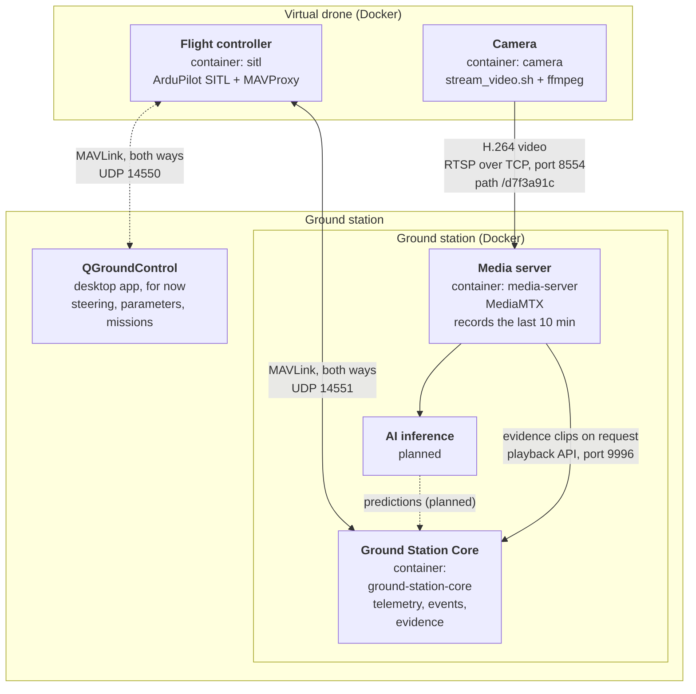

# Virtual Drone

Simulated drone for developing and testing the ground station without real hardware.

The drone runs in two Docker containers: a simulated flight controller that sends telemetry, and a simulated camera that sends live video. It has its own Docker network and reaches the ground station only through the ports the ground station opens, like a separate device would.

## Current Status

Currently implemented:

- simulated flight controller (ArduPilot SITL `Copter-4.7.2`)
- MAVLink telemetry to the Ground Station Core and QGroundControl
- simulated camera: recorded footage streamed live as H.264 over RTSP to MediaMTX
- separate Docker network for the drone, no published ports
- automatic restart of the camera if the ground station is not reachable yet

A fixed flight path (mission file), encryption, and running the drone on a Raspberry Pi 5 are planned but not implemented yet.

## Services

### SITL (flight controller)

[ArduPilot](https://ardupilot.org) is the autopilot software used on real drones. SITL ("Software In The Loop") runs the same code on a normal computer, with a physics model instead of motors and sensors. To the ground station it looks exactly like a real drone.

It:

- simulates a quadcopter starting at `HOME_LOCATION`
- runs MAVProxy, a small text-based ground station that forwards the telemetry
- sends MAVLink to QGroundControl and to the Ground Station Core
- receives commands back over the same connections (arm, take off, missions)
- resets its settings at every start, so every run begins the same way

The image is built in two stages: a build stage compiles ArduPilot once, and a small runtime image keeps only the compiled simulator, `sim_vehicle.py` and MAVProxy. MAVProxy is installed without its window libraries (`--no-deps`), which saves about 1.2 GB.

### Camera

The simulated drone has no camera. The camera container fills that gap by running `stream_video.sh`.

It:

- plays a recorded drone video (f.e. `zenmuse.mp4`) in real time
- re-encodes it like a drone's on-board encoder: constant 30 FPS, a keyframe (full picture) every second, low latency, capped bitrate (default 4 Mbit/s)
- publishes it over RTSP (TCP) to MediaMTX (`STREAM_KEY`)
- restarts by itself if MediaMTX is not reachable; the video then plays from the beginning

### QGroundControl (temporary)

[QGroundControl](https://qgroundcontrol.com) is a desktop app. For now it is used to steer the drone, change its parameters and plan the flight path. Once the flight path exists as a mission file, QGroundControl will be removed from the pipeline, together with the output to UDP 14550.

## How the Drone Connects



The drone only opens connections; nothing can connect to it. Data still flows both ways over those connections, e.g. commands from QGroundControl.

| Port | Protocol | Receiver |
|---|---|---|
| 8554 | TCP (RTSP) | MediaMTX: live video |
| 14550 | UDP (MAVLink) | QGroundControl (for now) |
| 14551 | UDP (MAVLink) | Ground Station Core: telemetry |

The AI inference service reads the live video from MediaMTX inside the ground station's Docker network (`rtsp://media-server:8554/d7f3a91c`, over TCP); it does not connect to the drone.

## Project Structure

```text
drone/
├── .env
├── .gitignore
├── README.md
├── compose.yml
├── sitl/
│   ├── Dockerfile
│   └── start_sitl.sh
├── camera/
│   ├── Dockerfile
│   └── stream_video.sh
└── videos/
    └── zenmuse.mp4
```

The videos are large and are not stored in git: put them into `videos/` yourself.

## Running

Install [Docker Desktop](https://docs.docker.com/desktop/) (macOS, Windows) or [Docker Engine](https://docs.docker.com/engine/install/) (Linux), and set up the ground station as described in `edge/ground-station/README.md`.

Run all commands from the drone folder. From the repository root:

```bash
cd edge/drone
```

Create a `.env` file in this folder with the settings listed under Development Configuration, and put the video (`zenmuse.mp4`) into the `videos/` folder.

Build the images. The first build compiles ArduPilot and takes about 15-20 minutes; later builds will be much faster:

```bash
docker compose build
```

Start the ground station **first**, then the drone (see Known Issues for why the order matters):

```bash
cd ../ground-station && docker compose up -d
```

```bash
cd ../drone && docker compose up -d
```

Check that the drone's containers are running:

```bash
docker compose ps
```

Stop the drone:

```bash
docker compose down
```

Stop the ground station:

```bash
cd ../ground-station && docker compose down
```

## Testing

### 1. Check the telemetry in the Ground Station Core

Asks the Core for the drone's latest telemetry. This proves that MAVLink gets from the drone into the Core; without it, events and the dashboard have no drone position.

```bash
curl http://localhost:8080/telemetry/latest
```

The answer looks like this (`curl` prints it on one line without the comments; shown formatted and commented here). All numbers are rounded: `lat` and `lon` to 7 decimals, everything else to 3.

```jsonc
{
  "drone_id": "550e8400-e29b-41d4-a716-446655440000",  // drone the telemetry belongs to (ground station .env)
  "lat": 55.767,                   // GPS latitude, degrees (7 decimals, about 1 cm)
  "lon": 12.3829999,               // GPS longitude, degrees (7 decimals, about 1 cm)
  "alt_rel_home_m": 0.0,           // altitude above the take-off point, metres
  "alt_amsl_m": 40.09,             // altitude above sea level, metres
  "vel_north_m_s": 0.0,            // speed towards north, m/s
  "vel_east_m_s": 0.0,             // speed towards east, m/s
  "vel_down_m_s": 0.0,             // speed downwards, m/s (negative = climbing)
  "roll_deg": 0.018,               // tilt left/right, degrees (0 = level)
  "pitch_deg": 0.008,              // nose up/down, degrees (0 = level)
  "yaw_deg": 1.211,                // where the nose points: 0 north, 90 east, -90 west, ±180 south
  "drone_time_s": 16.084,          // drone's own clock when roll/pitch/yaw were measured, s since start
  "battery_pct": 100.0,            // estimated battery charge, %
  "battery_v": 12.6,               // measured battery voltage, V
  "flight_mode": "STABILIZED",     // current flight mode (MAVSDK's names, see Known Issues)
  "armed": false,                  // whether the motors are armed
  "link_status": "OK",             // link health, see below
  "ground_speed_m_s": 0.0,         // horizontal speed, m/s
  "last_position_utc": "2026-11-02T21:31:27.103149+00:00"  // when the GSCore last received a position, UTC
}
```

`link_status` changes from `NO LINK` (no telemetry yet) to `NO FIX` (telemetry arrives, but the drone's GPS is not ready) after about 5 seconds, and to `OK` after about 15 seconds.

If the drone stops sending and no position has arrived within 2 seconds, `link_status` becomes `STALE`. When the drone is back, it returns to `OK`. `ERROR` means the Core's telemetry receiver failed; it tries to reconnect by itself every 5 seconds.

### 2. Watch the live video

Plays the stream from MediaMTX. This proves that the video gets from the drone's network to the ground station and that MediaMTX passes it on, which AI inference depends on.

```bash
ffplay rtsp://localhost:8554/d7f3a91c
```

### 3. Check that the video keeps up in real time

The video and the telemetry can only be matched correctly if the camera streams in real time. This log is where you can see that: the camera writes one progress line every 5 seconds.

```bash
docker compose logs -f camera
```

It looks like this:

```text
camera-1  | Streaming zenmuse.mp4 at 4M to host.docker.internal:8554/d7f3a91c (MediaMTX)
camera-1  | time=00:00:30 frame=911 fps=30.25 dropped=0 duplicated=49 speed=1.01x
```

`time` shows how far into the video the camera is.

`frame` counts the frames sent since the start.

`fps` is the number of frames per second (average).

`speed` is the encoding speed compared with real time (average) A `speed` above 1x means the camera is briefly ahead of real time. A `speed` below 1x means the camera falls behind.

`dropped` counts the frames left out by ffmpeg to keep a steady 30 FPS.

`duplicated` counts the frames ffmpeg showed twice to fill gaps in the recording. The video `zenmuse.mp4` has uneven gaps between its frames (about 29 frames per second), so this number keeps rising slowly.

### 4. Follow the flight controller

Shows the simulator's messages: GPS detected, mode changes, errors. This is the first place to look when no telemetry arrives.

```bash
docker compose logs -f sitl
```

### 5. Use the MAVProxy prompt

Sends commands straight to the flight controller, without QGroundControl. This proves that the drone accepts commands, and it is how a mission file will be loaded later.

```bash
docker compose attach sitl
```

Type commands such as `mode guided` or `arm throttle`. Leave with `Ctrl+P` then `Ctrl+Q`; `Ctrl+C` stops the simulator.

### 6. Fly with QGroundControl

Flies a mission. This proves that commands travel back to the drone through Docker, and gives the Core moving telemetry to work with instead of a drone standing still.

Open QGroundControl. It connects by itself. Wait for the GPS fix (about 40 seconds after the start), then plan, upload and start a mission. The video is about 16 minutes long.

## Development Configuration

The current development setup uses these values in `.env`:

```env
STREAM_KEY=d7f3a91c
VIDEO_DIR=./videos
VIDEO_FILE=zenmuse.mp4
BITRATE=4M
HOME_LOCATION=55.7670,12.3830,40,0
```

- `STREAM_KEY`: must match `STREAM_KEY` in `edge/ground-station/.env`.
- `VIDEO_DIR`: the folder with the videos; `./videos` is the `videos/` folder in `edge/drone` (also the default if it is not set).
- `VIDEO_FILE`: the video to play, inside `VIDEO_DIR`.
- `BITRATE`: video bitrate; drone video links typically carry 2–8 Mbit/s.
- `HOME_LOCATION`: latitude (55.7670), longitude (12.3830), altitude (40m), heading (0 degrees). The current values are near Hareskovby, north-west of Copenhagen.

## Known Issues

- **Start order.** Docker Desktop can't publish a UDP port while a container is already sending to it. If the ground station starts after the drone, the Core shows `NO LINK`. Fix: stop `sitl`, restart the ground station, start `sitl` again.
- **MAVSDK renames some flight modes**: ArduPilot's GUIDED shows as `OFFBOARD`, STABILIZE as `STABILIZED`(not that important).
- **The battery reading in the Ground Station Core** (`battery_pct`, `battery_v` in `/telemetry/latest`) is `null` for about 15–40 seconds after the drone starts. ArduPilot only starts sending its battery and system status a little after its position; this happens inside ArduPilot's start-up and is out of our control. Then it shows the simulated battery (100 %, 12.6 V).
- **One video source per stream path.** The ground station README's test step 1 publishes a test video to the same path (`d7f3a91c`). Use either the drone camera or that test step, not both.

## Roadmap

Planned additions include:

- a mission file that roughly follows the recorded footage, replacing QGroundControl
- telemetry routed through the camera container, so the drone has one exit like a real drone
- encrypted video and telemetry (RTSPS or SRT, WireGuard, MAVLink 2 signing)
- running the drone containers on a Raspberry Pi 5 as a separate physical device

These will be added step by step as the ground station pipeline grows.
