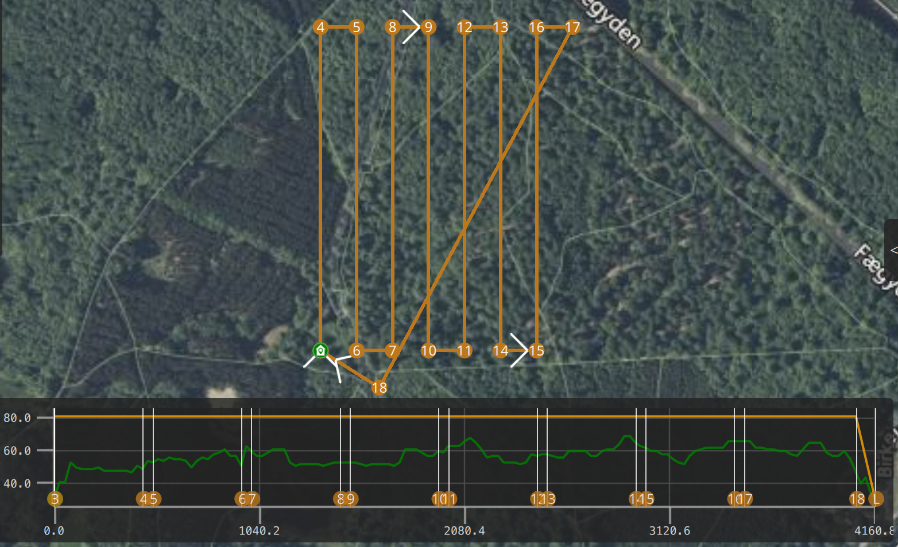
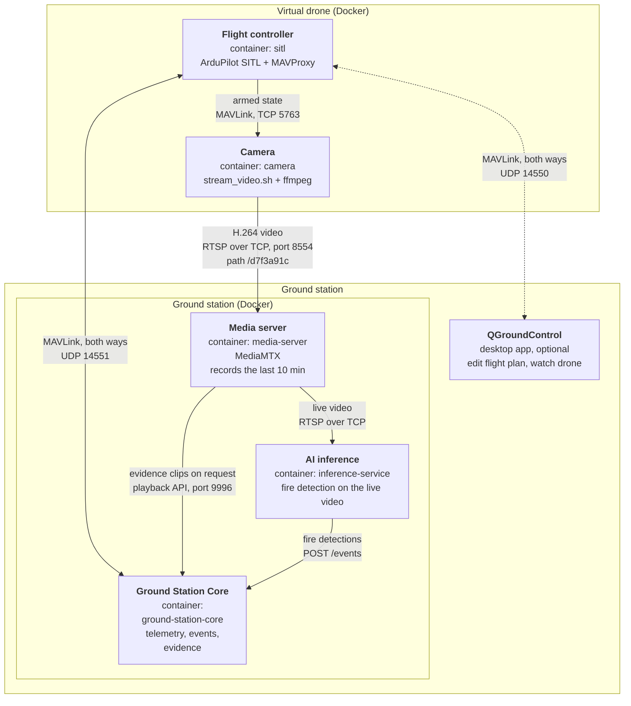

# Virtual Drone

Simulated drone for developing and testing the ground station without real hardware.

The drone runs in two Docker containers: a simulated flight controller that sends telemetry, and a simulated camera that sends live video. It has its own Docker network and reaches the ground station only through the ports the ground station opens, like a separate device would.

## Current Status

Currently implemented:

- simulated flight controller (ArduPilot SITL `Copter-4.7.2`)
- MAVLink telemetry to the Ground Station Core and QGroundControl
- simulated camera: recorded footage streamed live as H.264 over RTSP to MediaMTX
- separate Docker network for the drone, no published ports
- camera streams only while the drone is armed (follows the flight controller over MAVLink)
- automatic restart of the stream if the ground station is not reachable yet
- automatic flight of the survey path in `sitl/flight.plan` on every start

## Services

### SITL (flight controller)

[ArduPilot](https://ardupilot.org) is the autopilot software used on real drones. SITL ("Software In The Loop") runs the same code on a normal computer, with a physics model instead of motors and sensors. To the ground station it looks exactly like a real drone.

- simulates a quadcopter starting near Hareskovby, north-west of Copenhagen
- runs MAVProxy, a small text-based ground station that forwards the telemetry
- sends MAVLink to QGroundControl and to the Ground Station Core
- receives commands back over the same connections (arm, take off, missions)
- resets its settings at every start, so every run begins the same way
- flies the survey path in `flight.plan` automatically on every start

The image is built in two stages: a build stage compiles ArduPilot once, and a small runtime image keeps only the compiled simulator, `sim_vehicle.py` and MAVProxy. MAVProxy is installed without its window libraries (`--no-deps`), which saves about 1.2 GB.

`fly_mission.py` does the automatic flight: it uploads `flight.plan` (a QGroundControl plan file), waits until the pre-arm checks pass and the position estimate is ready (about 40 seconds), and then arms it once in AUTO mode, so no "Need Position Estimate" warnings appear. The drone then flies the mission by itself.

### Camera

The simulated drone has no camera. The camera container fills that gap. It runs `camera_control.py`, which reads the flight controller's heartbeat (MAVLink, TCP 5763): when the drone arms, it starts `stream_video.sh`; when the drone disarms or `sitl` disappears, it stops it.

- plays a recorded drone video (f.e. `zenmuse.mp4`) in real time
- re-encodes it like a drone's on-board encoder: constant 30 FPS, a keyframe (full picture) every second, low latency, capped bitrate (default 4 Mbit/s)
- publishes it over RTSP (TCP) to MediaMTX (`STREAM_KEY`)
- restarts the stream after 2 seconds if MediaMTX is not reachable; the video then plays from the beginning
- the container itself restarts only if `camera_control.py` crashes; a camera you stopped yourself stays stopped (`unless-stopped`)

### QGroundControl

[QGroundControl](https://qgroundcontrol.com) is a desktop app. It is not needed to fly: the drone flies `flight.plan` by itself. It is used to:

- edit the flight path: open `sitl/flight.plan`, change it, save it, then rebuild the drone (`docker compose up -d --build sitl`)
- watch the drone on a map while it flies (it receives the telemetry on UDP 14550)


### Flight path



Upon opening the `flight.plan`, you can see the above. The drone flies a back and forth path over the forest. It then flies back past home and lands there. The path is about 4.2 km long and takes about 16 minutes.

The graph below the map shows the planned altitude (orange) and the ground height (green) along the path, in metres above sea level.

## How the Drone Connects



The drone only opens connections; nothing can connect to it. Data still flows both ways over those connections, e.g. commands from QGroundControl.

| Port | Protocol | Receiver |
|---|---|---|
| 8554 | TCP (RTSP) | MediaMTX: live video |
| 14550 | UDP (MAVLink) | QGroundControl (optional) |
| 14551 | UDP (MAVLink) | Ground Station Core: telemetry |

The AI inference service reads the live video from MediaMTX inside the ground station's Docker network (`rtsp://media-server:8554/d7f3a91c`, over TCP); it does not connect to the drone.

## How Drones Authenticate with GS
1. Session Establishment: When the drone receives a mission, it establishes an authenticated session with the ground station using the edge/drone/auth module and RSA certificates for authentication.
2. Telemetry Signing: Once the session is established, the drone uses the derived session key to sign outgoing telemetry messages through MAVProxy's MAVLink signing functionality before transmitting them to its authenticated ground station.
3. Session Revocation: Once the mission is completed and the drone has safely returned to its home location and stopped, it revokes the established session using the revoke session functionality in the edge/drone/auth module. This terminates the session and prevents further use of the session key.
## Project Structure

```text
drone/
├── .env
├── .gitignore
├── README.md
├── compose.yml
├── sitl/
│   ├── Dockerfile
│   ├── flight.plan
│   ├── fly_mission.py
│   ├── mavic-battery.json
│   └── start_sitl.sh
├── camera/
│   ├── Dockerfile
│   ├── camera_control.py
│   └── stream_video.sh
├── images/
│   └── flight-path.png
└── videos/
    └── zenmuse.mp4
```

The videos are large and are not stored in git: put them into `videos/` yourself.

## Running

Install [Docker Desktop](https://docs.docker.com/desktop/) (macOS, Windows) or [Docker Engine](https://docs.docker.com/engine/install/) (Linux), and set up the ground station as described in `edge/ground-station/README.md`.

Run all commands from the drone folder. From the repository root:

```bash
cd edge/drone
```

Create a `.env` file in this folder with the settings listed under Development Configuration, and put the video (`zenmuse.mp4`) into the `videos/` folder.

Build the images. The first build compiles ArduPilot and takes about 15-20 minutes; later builds will be much faster:

```bash
docker compose build
```

Start the ground station **first**, then the drone (see Known Issues for why the order matters):

```bash
cd ../ground-station && docker compose up -d
```

```bash
cd ../drone && docker compose up -d
```

About 40 seconds after the start, the drone takes off by itself and flies the flight path (see Flight path). After about 16 minutes it lands back at home.

Check that the drone's containers are running:

```bash
docker compose ps
```

To fly a changed flight path, edit `sitl/flight.plan` in QGroundControl, save it, then rebuild and restart the drone:

```bash
docker compose up -d --build sitl
```

To stop the drone:

```bash
docker compose down
```

To stop the ground station:

```bash
cd ../ground-station && docker compose down
```

## Testing

### 1. Check the telemetry in the Ground Station Core

Asks the Core for the drone's latest telemetry. This proves that MAVLink gets from the drone into the Core; without it, events and the dashboard have no drone position.

```bash
curl http://localhost:8080/telemetry/latest
```

The answer looks like this (shown formatted and commented here for better readability).

```jsonc
{
  "drone_id": "550e8400-e29b-41d4-a716-446655440000",  // drone the telemetry belongs to (ground station .env)
  "lat": 55.767,                   // GPS latitude, degrees (7 decimals, about 1 cm)
  "lon": 12.3829999,               // GPS longitude, degrees (7 decimals, about 1 cm)
  "alt_rel_home_m": 0.0,           // altitude above the take-off point, metres
  "alt_amsl_m": 40.09,             // altitude above sea level, metres
  "vel_north_m_s": 0.0,            // speed towards north, m/s
  "vel_east_m_s": 0.0,             // speed towards east, m/s
  "vel_down_m_s": 0.0,             // speed downwards, m/s (negative = climbing)
  "roll_deg": 0.018,               // tilt left/right, degrees (0 = level)
  "pitch_deg": 0.008,              // nose up/down, degrees (0 = level)
  "yaw_deg": 1.211,                // where the nose points: 0 north, 90 east, -90 west, ±180 south
  "drone_time_s": 16.084,          // drone's own clock when roll/pitch/yaw were measured, s since start
  "battery_pct": 100.0,            // estimated battery charge, %
  "battery_v": 12.6,               // measured battery voltage, V
  "flight_mode": "STABILIZED",     // current flight mode (MAVSDK's names, see Known Issues)
  "armed": false,                  // whether the motors are armed
  "link_status": "OK",             // link health, see below
  "ground_speed_m_s": 0.0,         // horizontal speed, m/s
  "last_position_utc": "2026-11-02T21:31:27.103149+00:00"  // when the GSCore last received a position, UTC
}
```

`link_status` changes from `NO LINK` (no telemetry yet) to `NO FIX` (telemetry arrives, but the drone's GPS is not ready) after about 5 seconds, and to `OK` after about 15 seconds.

If the drone stops sending and no position has arrived within 2 seconds, `link_status` becomes `STALE`. When the drone is back, it returns to `OK`. `ERROR` means the Core's telemetry receiver failed; it tries to reconnect by itself every 5 seconds.

### 2. Watch the live video

Plays the stream from MediaMTX. This proves that the video gets from the drone's network to the ground station and that MediaMTX passes it on, which AI inference depends on.

Open [VLC](https://www.videolan.org) (Windows, macOS, Linux), choose File → Open Network and enter:

```text
rtsp://localhost:8554/d7f3a91c
```

MediaMTX only accepts RTSP over TCP. If the picture stays black, enable "Use RTP over RTSP (TCP)" in VLC's preferences (Show All → Input/Codecs → Demuxers → RTP/RTSP).

### 3. Check that the video keeps up in real time

The video and the telemetry can only be matched correctly if the camera streams in real time. This log is where you can see that: the camera writes one progress line every 5 seconds. These lines only appear once the drone has armed; before that, the log shows `camera: connected to the flight controller`.

```bash
docker compose logs -f camera
```

It looks like this:

```text
camera-1  | Streaming zenmuse.mp4 at 4M to host.docker.internal:8554/d7f3a91c (MediaMTX)
camera-1  | time=00:00:30 frame=911 fps=30.25 dropped=0 duplicated=49 speed=1.01x
```

`time` shows how far into the video the camera is.

`frame` counts the frames sent since the start.

`fps` is the number of frames per second (average).

`speed` is the encoding speed compared with real time (average) A `speed` above 1x means the camera is briefly ahead of real time. A `speed` below 1x means the camera falls behind.

`dropped` counts the frames left out by ffmpeg to keep a steady 30 FPS.

`duplicated` counts the frames ffmpeg showed twice to fill gaps in the recording. The video `zenmuse.mp4` has uneven gaps between its frames (about 29 frames per second), so this number keeps rising slowly.

### 4. Follow the flight controller

Shows the simulator's messages: GPS detected, mode changes, errors. This is the first place to look when no telemetry arrives.

```bash
docker compose logs -f sitl
```

### 5. Watch the drone in QGroundControl

Shows the drone on a map while it flies the flight path.

Open QGroundControl. It connects by itself and shows the drone's position, the flight path, and its altitude, speed, battery and flight mode. The drone takes off about 40 seconds after the start. The whole flight takes approx. 16 minutes, about as long as the video.

## Development Configuration

The current development setup uses these values in `.env`:

```env
GROUND_HOST=host.docker.internal
STREAM_KEY=d7f3a91c
VIDEO_FILE=zenmuse.mp4
BITRATE=4M
```

- `GROUND_HOST`: the computer running the ground station. `host.docker.internal` means the same computer as the drone; on the Raspberry Pi, use the ground station computer's IP address.
- `STREAM_KEY`: must match `STREAM_KEY` in `edge/ground-station/.env`.
- `VIDEO_FILE`: the video to play, inside the `videos/` folder.
- `BITRATE`: video bitrate; drone video links typically carry 2–8 Mbit/s.

## Known Issues

- **Start order.** Docker Desktop can't publish a UDP port while a container is already sending to it. If the ground station starts after the drone, the Core shows `NO LINK`. Fix: stop `sitl`, restart the ground station, start `sitl` again.
- **MAVSDK renames some flight modes**: ArduPilot's GUIDED shows as `OFFBOARD`, STABILIZE as `STABILIZED`(not that important).
- **The flight path matches `zenmuse.mp4`.** `flight.plan` was made to take about as long as that video (about 16 minutes). Another video whose length differs significantly needs a different flight path.
- **One video source per stream path.** The ground station README's test step 1 publishes a test video to the same path (`d7f3a91c`). Use either the drone camera or that test step, not both.

## Roadmap

Planned additions include:

- encrypted video and telemetry (RTSPS or SRT, WireGuard, MAVLink 2 signing)
- running the drone containers on a Raspberry Pi 5 as a separate physical device
- resume the video where it stopped after a camera restart: today it starts from the beginning, so the video no longer matches the flight path

These will be added step by step as the ground station pipeline grows.
