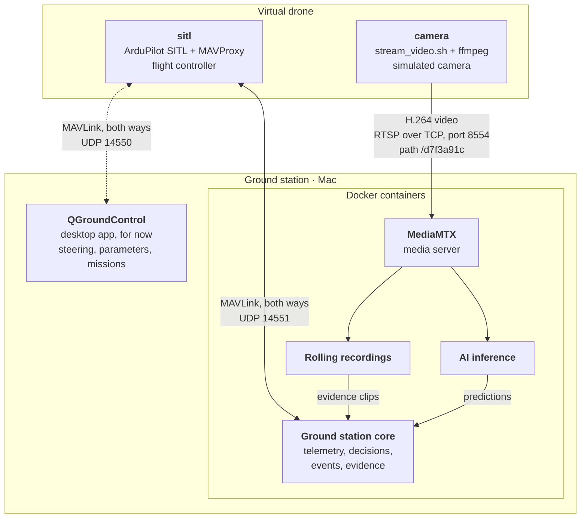

# Virtual Drone

Simulated drone for developing and testing the ground station without real hardware.

The drone runs in two Docker containers: a simulated flight controller that sends telemetry, and a simulated camera that sends live video. It has its own Docker network and reaches the ground station only through the ports the ground station opens, like a separate device would.

## Current Status

Currently implemented:

- simulated flight controller (ArduPilot SITL `Copter-4.7.2`)
- MAVLink telemetry to the Ground Station Core (UDP 14551) and QGroundControl (UDP 14550)
- simulated camera: recorded footage streamed live as H.264 over RTSP to MediaMTX
- separate Docker network for the drone, no published ports
- automatic restart of the camera if the ground station is not reachable yet

A fixed flight path (mission file), encryption, and running the drone on a Raspberry Pi 5 are planned but not implemented yet.

## Services

### SITL (flight controller)

[ArduPilot](https://ardupilot.org) is the autopilot software used on real drones. SITL ("Software In The Loop") runs the same code on a normal computer, with a physics model instead of motors and sensors. To the ground station it looks exactly like a real drone.

It:

- simulates a quadcopter starting at `HOME_LOCATION`
- runs MAVProxy, a small text-based ground station that forwards the telemetry
- sends MAVLink to QGroundControl (UDP 14550) and to the Ground Station Core (UDP 14551)
- receives commands back over the same connections (arm, take off, missions)
- resets its settings at every start, so every run begins the same way

The image is built in two stages: a build stage compiles ArduPilot once, and a small runtime image keeps only the compiled simulator, `sim_vehicle.py` and MAVProxy.

### Camera

SITL has no camera. The camera container fills that gap by running `stream_video.sh`.

It:

- plays a recorded drone video (`zenmuse.mp4`) in real time
- re-encodes it like a drone's on-board encoder: constant 30 FPS, a keyframe every second, low latency, capped bitrate (default 4 Mbit/s)
- publishes it over RTSP (TCP) to MediaMTX, on the drone's own stream path (`STREAM_KEY`)
- restarts by itself if MediaMTX is not reachable; the video then plays from the beginning

### QGroundControl (temporary)

[QGroundControl](https://qgroundcontrol.com) is a desktop app on the Mac, not a container. For now it is used to steer the drone, change its parameters and plan the flight path. Once the flight path exists as a mission file, QGroundControl will be removed from the pipeline, together with the output to UDP 14550.

## How the Drone Connects



The drone only opens connections; nothing can connect to it. Data still flows both ways over those connections, e.g. commands from QGroundControl.

| Port | Protocol | Receiver |
|---|---|---|
| 8554 | TCP (RTSP) | MediaMTX: live video |
| 14550 | UDP (MAVLink) | QGroundControl (for now) |
| 14551 | UDP (MAVLink) | Ground Station Core: telemetry |

`host.docker.internal` is Docker's name for the computer the containers run on. Docker Desktop provides it; on Linux, `compose.yml` adds it.

## Project Structure

```text
drone/
├── .env
├── .env.example
├── .dockerignore
├── README.md
├── compose.yml
├── stream_video.sh
├── sitl/
│   ├── Dockerfile
│   └── start_sitl.sh
└── camera/
    └── Dockerfile
```

## Running

Install [Docker Desktop](https://docs.docker.com/desktop/) (macOS, Windows) or [Docker Engine](https://docs.docker.com/engine/install/) (Linux), and set up the ground station as described in `edge/ground-station/README.md`.

Create the settings file and set `VIDEO_DIR` to your video folder:

```bash
cp .env.example .env
```

Build the images. The first build compiles ArduPilot and takes about 15 minutes; later builds use the cache:

```bash
docker compose build
```

Start the ground station **first**, then the drone (see Known Issues for why the order matters):

```bash
cd ../ground-station && docker compose up -d
```

```bash
cd ../drone && docker compose up -d
```

Check that they are running:

```bash
docker compose ps
```

Stop the drone:

```bash
docker compose down
```

## Testing

### 1. Check the telemetry in the Ground Station Core

Asks the Core for the drone's latest telemetry. This proves that MAVLink gets from the drone into the Core; without it, events and the dashboard have no drone position.

```bash
curl http://localhost:8080/telemetry/latest
```

`link_status` changes from `NO LINK` to `NO FIX` and, after about 10 seconds, to `OK`.

### 2. Watch the live video

Plays the stream from MediaMTX. This proves that the video gets from the drone's network to the ground station and that MediaMTX passes it on, which AI inference depends on.

```bash
ffplay rtsp://localhost:8554/d7f3a91c
```

### 3. Check that the video keeps up in real time

Shows ffmpeg's progress. If the camera can't encode fast enough, the video falls behind and no longer matches the telemetry. This matters most on slower hardware such as the Raspberry Pi.

```bash
docker logs -f wildfire-drone-camera-1
```

The progress line should show `fps=30` and `speed=1x`.

### 4. Follow the flight controller

Shows the simulator's messages: GPS detected, mode changes, errors. This is the first place to look when no telemetry arrives.

```bash
docker compose logs -f sitl
```

### 5. Use the MAVProxy prompt

Sends commands straight to the flight controller, without QGroundControl. This proves that the drone accepts commands, and it is how a mission file will be loaded later.

```bash
docker compose attach sitl
```

Type commands such as `mode guided` or `arm throttle`. Leave with `Ctrl+P` then `Ctrl+Q`; `Ctrl+C` stops the simulator.

### 6. Fly with QGroundControl

Flies a mission. This proves that commands travel back to the drone through Docker, and gives the Core moving telemetry to work with instead of a drone standing still.

Open QGroundControl. It connects by itself. Wait for the GPS fix (about 40 seconds after the start), then plan, upload and start a mission. The video is about 16 minutes long.

## Development Configuration

Settings in `.env`:

```env
GROUND_HOST=host.docker.internal
STREAM_KEY=d7f3a91c
VIDEO_DIR=/Users/andreas/wildfire-prediction-uav/media/videos
VIDEO_FILE=zenmuse.mp4
BITRATE=4M
HOME_LOCATION=55.7670,12.3830,40,0
```

- `GROUND_HOST`: the ground station. Use its IP address when the drone runs on another device.
- `STREAM_KEY`: must match `STREAM_KEY` in `edge/ground-station/.env`.
- `VIDEO_DIR`: full path to the folder with the video (no `~`).
- `VIDEO_FILE`: the video to play, inside `VIDEO_DIR`.
- `BITRATE`: video bitrate; drone video links typically carry 2–8 Mbit/s.
- `HOME_LOCATION`: latitude, longitude, altitude (m), heading (degrees).

**Why `.env` and `.env.example`?** `.env` holds your own settings, and Docker Compose reads it automatically. It is not stored in git, because the values differ per computer (for example `VIDEO_DIR`) and later it may hold secrets such as encryption keys. `.env.example` is stored in git: it lists every setting with example values, so a teammate copies it to `.env` and adjusts it.

**Why `VIDEO_DIR` and `VIDEO_FILE`?** Docker mounts the folder `VIDEO_DIR` read-only into the camera container as `/videos`, and the camera plays `/videos/<VIDEO_FILE>`. The folder is a path on your computer, the file name is used inside the container, so they are two settings. To play another video from the same folder, change only `VIDEO_FILE`.

## Known Issues

- **Start order.** Docker Desktop can't publish a UDP port while a container is already sending to it. If the ground station starts after the drone, the Core shows `NO LINK`. Fix: stop `sitl`, restart the ground station, start `sitl` again.
- **`docker compose logs` hides ffmpeg's progress**, because those lines end in a carriage return. Use `docker logs -f wildfire-drone-camera-1`.
- **MAVProxy's normal install** pulls in 1.2 GB of window libraries. It is installed with `--no-deps`, which keeps the SITL image at 514 MB instead of 1.75 GB.
- **MAVSDK renames some flight modes**: ArduPilot's GUIDED shows as `OFFBOARD`, STABILIZE as `STABILIZED`.
- **The battery reading** is `null` for the first seconds after the start.

## Roadmap

Planned additions include:

- a mission file that roughly follows the recorded footage, replacing QGroundControl
- telemetry routed through the camera container, so the drone has one exit like a real drone
- encrypted video and telemetry (RTSPS or SRT, WireGuard, MAVLink 2 signing)
- running the drone containers on a Raspberry Pi 5 as a separate physical device

These will be added step by step as the ground station pipeline grows.
